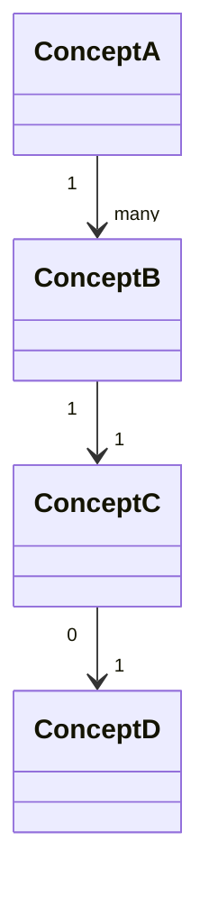

# 概念モデリング

---

## 1. 目的

- モデルの対象となる名詞（概念）を抽出する
- 概念同士の関係を明確にして、ドメインの静的な構造を定義する
- 用語の意味を揃え、後のデータモデルやテーブルに流用できる共通言語を作る

---

## 2. 必要な情報

- 要件
- ユースケース（一覧と各ユースケースのシナリオ・事前条件・事後条件）

---

## 3. 手順

1. ユースケースのシナリオ・事前条件・事後条件に登場する名詞を洗い出す
2. 動詞になっているものは名詞に言い換える（「購入する」→「購入」「注文」）
3. 同じものを指す別の名前がないか確かめ、1つの名前に揃える
4. 概念一覧を作り、各概念の用語定義を1〜2行で書く
5. 概念同士の関係と多重度（1対1、1対多、多対多）を書く
6. traceability-check に従い、ユースケースに登場する名詞がすべて概念一覧にあるか確かめる。含めないものは理由を書く
7. 完了条件を確かめる

---

## 4. 出力フォーマット

````markdown
## 概念モデル

### 概念一覧（名詞）
- ConceptA
- ConceptB
- ConceptC
- ConceptD

### 関係（テキスト形式）
- ConceptA - ConceptB : 1..*   # ConceptA は ConceptB を複数持つ
- ConceptB - ConceptC : 1..1   # ConceptB は ConceptC と1対1
- ConceptC - ConceptD : 0..1   # ConceptC は ConceptD を持つ場合もある

### 用語の定義
- ConceptA：このアプリ内で何を指すか
- ConceptB：このアプリ内で何を指すか
- ConceptC：このアプリ内で何を指すか
- ConceptD：このアプリ内で何を指すか

### 図


````

---

## 5. 品質評価基準

### OKの基準（すべて満たすこと）

| 基準ID | 基準 |
|---|---|
| CM-01 | ユースケースで登場した名詞が概念一覧に含まれている |
| CM-02 | 概念同士の関係（1対多・1対1など）が記載されている |
| CM-03 | 多対多の関係がある場合、それが明示されている |
| CM-04 | 各概念の用語定義が書かれている（何を指すか1〜2行で） |

### よくある不十分パターン

- 概念が動詞になっている（「購入する」→「購入」「注文」などの名詞に変換が必要）（CM-01）
- 関係の多重度が書かれていない（1対多なのか1対1なのかが不明）（CM-02）
- ユースケースで使っている名詞が概念モデルに存在しない（用語の乖離）（CM-01）

---

## 6. 完了条件

- ユースケースに登場する名詞が、すべて概念一覧にあるか、含めない理由が書かれている
- すべての概念に用語定義と、他の概念との関係が書かれている
- 品質評価基準 CM-01〜CM-04 を満たしている

---

## 7. AIに任せない判断の例

| 場面 | 該当する領域 |
|---|---|
| 関係の多重度が要件から読み取れない（1人が複数持てるのか、1つだけか） | 要件の解釈が割れる |
| 要件で使われている言葉の意味が、場所によって違うように読める | 用語の新規定義・意味の変更 |
| ユースケースに登場しない概念を足したくなった | スコープの追加・削除 |
| ユースケースに誤りや不足を見つけた | 前工程の成果物の変更（差し戻し提案） |

人間に確認するときの聞き方の例：

- 「〇〇と△△の関係は1対多ですか、多対多ですか？」
- 「ユースケースに登場した『××』は概念モデルに含めなくてよいですか？」
