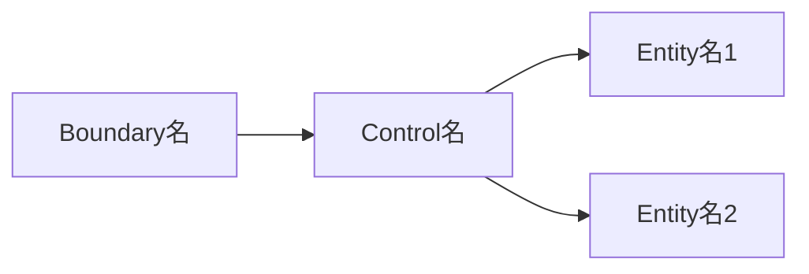

# 責務割り当て

※ 一般にはロバストネス分析と呼ばれる工程。馴染みのない人にも分かりやすいように「責務割り当て」と呼ぶ。

---

## 1. 目的

- ユースケース（振る舞い）と概念モデル（名詞）をもとに、シナリオの各ステップを入出力／制御ロジック／データモデルに振り分ける
- 誰が何を担当するか（責務）を明確にする
- 概念モデルを実行可能な構造に近づけ、後のクラス設計に直結させる

---

## 2. 必要な情報

- ユースケース（主シナリオ・代替シナリオ・事後条件）
- 概念モデル（概念一覧・関係・用語の定義）

---

## 3. 手順

1. 入出力（画面・エンドポイント）、制御ロジック、データモデルの一覧を作る。データモデルは概念一覧の名前を使う
2. ユースケースごとに、主シナリオの各ステップを入出力／制御ロジック／データモデルに振り分ける。判断は下の「処理ブロックの区分」に従う
3. 入出力 → 制御ロジック → データモデル の依存図を書く
4. ユースケースの事後条件を、Entity 単位に展開する（「事後条件のEntity単位変換表」）
   - 1つの事後条件が複数のEntityにまたがる場合は、Entityごとに行を分ける
   - 「状態遷移」は status などの状態が変わるもの。内容には「受付 → 確定」のように遷移前後を書く
5. coupling-evaluation に従い、制御ロジックがデータモデルの内部に踏み込んでいないか確かめる
6. traceability-check に従い、すべてのステップと事後条件が扱われているか確かめる
7. 完了条件を確かめる

### 処理ブロックの区分

| 区分 | 担当 | 判断基準 |
|---|---|---|
| 入出力（Boundary） | ユーザーや外部からの入力を受け取り、結果を返す。画面やAPIの入口など外界との境界 | 入力を受ける？ 出力を返す？ |
| 制御ロジック（Control） | ユースケースの流れを順番に進める司令塔。必要に応じて複数のデータモデルを呼び出して調整する。自身ではビジネスルールや状態を持たない | 複数の処理やデータモデルをつなぐ？ ユースケース全体の流れを担当する？ |
| データモデル（Entity） | 自分自身の状態・データ・ビジネスルールを持つ。自分のことだけ正しく処理し、他のデータモデルの調整はしない | 自分の状態を変える？ ビジネスルールを持つ？ |

例：
- 入出力：商品詳細画面、POST /cart/add、カート画面
- 制御ロジック：CartService（「商品取得 → 在庫確認 → カート更新」をまとめて行う処理）
- データモデル：Cart（addItem、updateQuantity）、CartItem、Stock（在庫数の変動処理）

---

## 4. 出力フォーマット

````markdown
## 責務割り当て

### 処理ブロックの種類

#### 入出力（Boundary）
- ［画面名／エンドポイント］

#### 制御ロジック（Control）
- ［ユースケースを進めるための処理単位］

#### データモデル（Entity）
- ［概念モデルの名詞］

---

### シナリオ担当の振り分け（B / C / E）

#### UC-XX（名前）
1. ［ステップ内容］ … B
2. ［ステップ内容］ … C
3. ［ステップ内容］ … E

（※ B=Boundary, C=Control, E=Entity）

---

### B→C→E 依存図



---

### 事後条件のEntity単位変換表

| UC-ID | 事後条件 | Entity | 変化の種類 | 内容 |
| --- | --- | --- | --- | --- |
| UC-XX | ［ユースケースの事後条件］ | E:［Entity名］ | ［生成／更新／状態遷移／削除］ | ［何がどう変わるか］ |

（※ 変化の種類は 生成／更新／状態遷移／削除 の4種から選ぶ）
````

記入例（事後条件のEntity単位変換表）：

| UC-ID | 事後条件 | Entity | 変化の種類 | 内容 |
|---|---|---|---|---|
| UC-05 | 注文が確定した | E:注文 | 生成 | 購入内容で注文を新規作成 |
| UC-05 | 注文が確定した | E:注文 | 状態遷移 | 未決済 → 決済済 |
| UC-05 | 在庫が引き当てられた | E:在庫 | 更新 | 購入数分の在庫数を減算 |
| UC-05 | カートが空になった | E:カート明細 | 削除 | 購入した明細を削除 |

この表は後工程の抽出元になる。
- 品質リスク分析：「更新」「状態遷移」「削除」の行 → 整合性リスクの候補
- テーブル設計：「状態遷移」の行 → 状態カラム（status 等）の候補

---

## 5. 品質評価基準

### OKの基準（すべて満たすこと）

| 基準ID | 基準 |
|---|---|
| RA-01 | 主シナリオの全ステップが入出力／制御ロジック／データモデルのいずれかに分類されている |
| RA-02 | 入出力が最低1つある（入口となる画面またはAPIが存在する） |
| RA-03 | 制御ロジックがデータモデルを呼び出す流れになっており、逆転していない |
| RA-04 | データモデルが制御ロジックの処理を呼び出す構造になっていない |
| RA-05 | 概念モデルの名詞がデータモデルとして登場している |
| RA-06 | ユースケースのすべての事後条件が、事後条件のEntity単位変換表に展開されている |
| RA-07 | 変換表のEntityがすべて概念一覧に存在する |
| RA-08 | 変化の種類が 生成／更新／状態遷移／削除 のいずれかになっている |

### よくある不十分パターン

- 全ステップが制御ロジックになっている（データモデルへの責務移譲ができていない）（RA-01）
- 入出力が制御ロジックの処理を直接行っている（境界の役割を超えている）（RA-03）
- 概念モデルに存在しない名詞がデータモデルとして出てくる（RA-07）
- 事後条件が曖昧で、どのEntityがどう変わるか展開できない（RA-06。ユースケースの差し戻し提案になる）

---

## 6. 完了条件

- すべてのユースケースの主シナリオのステップが振り分けられている
- すべての事後条件が Entity 単位に展開されている
- 品質評価基準 RA-01〜RA-08 を満たしている

---

## 7. AIに任せない判断の例

| 場面 | 該当する領域 |
|---|---|
| 事後条件が曖昧で、どのEntityがどう変わるか決められない | 前工程の成果物の変更（差し戻し提案） |
| 概念モデルにない名詞をデータモデルにしたくなった | 前工程の成果物の変更（差し戻し提案） |
| 業務ルールを、どのデータモデルが持つかが要件から読み取れない | 要件の解釈が割れる |

人間に確認するときの聞き方の例：

- 「ステップ〇の『在庫チェック』は在庫のルール判定なので、データモデルが担当すべきではないですか？」
- 「このステップは入出力が処理しているように見えます。制御ロジックに移すべき処理が含まれていませんか？」
