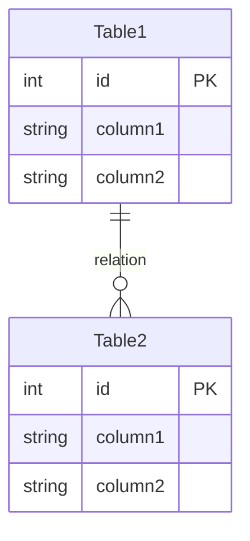

# テーブル設計

---

## 1. 目的

概念モデルとデータモデルのクラスをもとに、論理テーブルの候補を導出し、正規化を検証する。

---

## 2. 必要な情報

- 概念モデル（概念一覧・関係・用語の定義）
- 責務割り当て（事後条件のEntity単位変換表、シナリオ担当の振り分け）
- データモデル（クラス一覧・プロパティ）

---

## 3. 手順

### Step 1：Entity の選別

- 概念一覧から「状態・ライフサイクルを持つもの」を Entity 候補にする
- 「属性の集まりにすぎないもの」は Entity の属性として吸収する
- 判断基準：それ単体で CRUD されるか？ → Yes なら Entity

### Step 2：リレーションの導出

概念モデルの関係を次のように分類する。

- 1:1 → FK で片方に寄せるか、同一テーブルに統合
- 1:N → N 側に FK を持たせる
- N:N → 中間テーブルを作る（この時点でテーブル数が増える）

概念モデルに関係線がないのにシナリオで一緒に使われる概念があれば、関係の漏れを疑う。

### Step 3：属性の配置

- 概念モデルの用語定義 → カラム候補
- 事後条件のEntity単位変換表 → 状態カラム（status 等）の抽出元
- シナリオで「検索・フィルタ・ソートに使う」属性 → インデックス候補としてマーク

### Step 4：ID 体系の決定

- 自然キー（業務上の一意キー）があるか確かめる
- サロゲートキー（auto increment／UUID）を基本とし、自然キーは UNIQUE 制約で補う

### Step 5：正規化の検証

テーブル候補を書き出した後、下の「正規化チェックリスト」を上から順に確かめる。

### Step 6：完了条件を確かめる

### 正規化チェックリスト

**1NF（繰り返しの排除）**
- カラムに配列・カンマ区切り・JSON 配列を入れていないか
- 「item1, item2, item3」のような横持ちになっていないか
- → 該当したら子テーブルに分離

**2NF（部分関数従属の排除）**
- 複合 PK のテーブルで、PK の一部だけに依存するカラムがないか
- 例：（注文ID, 商品ID）が PK の場合、「商品名」は商品ID だけに依存
- → 該当したら別テーブルに分離

**3NF（推移的関数従属の排除）**
- PK 以外のカラムが、別の非キーカラムに依存していないか
- 例：「商品カテゴリ名」が「商品カテゴリID」に依存し、PK には直接依存しない
- → 該当したらマスタテーブルに分離

**リレーション整合性**
- 概念モデルの関係線と ER 図の FK／中間テーブルが1対1で対応しているか
- 概念モデルにある関係で ER 図に反映されていないものがないか

**実用上の非正規化判断**
- あえて非正規化する箇所があれば、理由を明記する（例：「参照頻度が極めて高く、JOIN コストを避けるため商品名を注文明細にも持つ」）
- 非正規化した場合の整合性維持方針を書く

---

## 4. 出力フォーマット

````markdown
#### 論理テーブル（候補）
- ［テーブル名］（PK: id）
  - ［主カラム］
- ［テーブル名］（PK: id）
  - ［主カラム］

#### ER 図



#### 正規化チェック結果
- 1NF：［確認結果］
- 2NF：［確認結果］
- 3NF：［確認結果］
- リレーション整合性：［確認結果］
- 非正規化：［箇所・理由・整合性維持方針。なければ「なし」］
````

---

## 5. 品質評価基準

### OKの基準（すべて満たすこと）

| 基準ID | 基準 |
|---|---|
| TD-01 | 論理テーブル候補が Entity と対応している（Step 1 で吸収した概念は理由が分かる） |
| TD-02 | PK/FK が定義されている |
| TD-03 | 多対多の関係に中間テーブルがある |
| TD-04 | 正規化チェックリストの全項目を確認している |
| TD-05 | 非正規化した箇所に理由と整合性維持方針が書かれている |

### よくある不十分パターン

- 多対多の中間テーブルが見落とされている（TD-03）
- 概念モデルにある関係が ER 図に反映されていない（TD-04）
- 非正規化しているのに理由が書かれていない（TD-05）

---

## 6. 完了条件

- すべての Entity 候補がテーブルになっているか、吸収した理由が書かれている
- 正規化チェックリストの結果が書かれている
- 品質評価基準 TD-01〜TD-05 を満たしている

---

## 7. AIに任せない判断の例

| 場面 | 該当する領域 |
|---|---|
| 概念モデルにない関係を足したくなった（関係の漏れを見つけた） | 前工程の成果物の変更（差し戻し提案） |
| 自然キーになりそうな業務上の値があるが、一意かどうかが要件から読み取れない | 要件の解釈が割れる |
| 性能のために非正規化したくなった | 品質リスクへの目標値（非正規化の根拠になる負荷の想定） |
